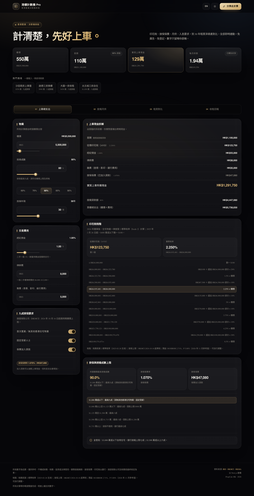
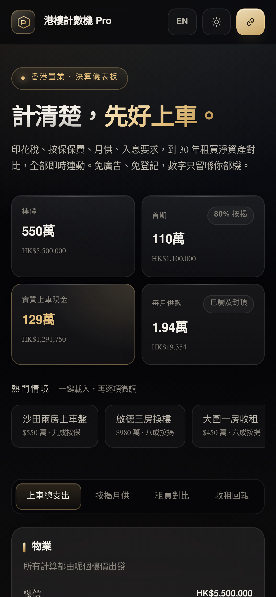

<div align="center">


# 港樓計數機 Pro · PropCalc HK

**香港置業決策儀表板** — 印花稅、按保、月供、入息、30 年租買對比、收租回報，一頁即時計清。


[功能](#功能--features) · [計算依據](#計算依據--methodology) · [快速開始](#快速開始--getting-started) · [私隱](#私隱--privacy) · [免責聲明](#免責聲明--disclaimer)

</div>



<p align="center">
  
</p>

---

## 功能 / Features

### 01 · 上車總支出 — Upfront cash

| 中文 | English |
| --- | --- |
| 樓價、按揭成數（六成至九成，含按保上限判斷）、按揭年期 10–30 年 | Price, LTV from 60% to 90% with MIP cap checks, 10–30 year term |
| 從價印花稅（AVD 第 2 標準稅率）全自動按最新稅階計算，並列出完整稅階同適用級別 | Full ad valorem stamp duty at Scale 2, with the whole bracket table and the band applied |
| 經紀佣金（預設 1%，可調）、律師費、雜費 | Agent commission (1% by default, adjustable), solicitor fee, disbursements |
| 按保保費估算（HKMCI 保費表，按樓價、成數、年期），可選擇加入貸款或以現金支付 | Mortgage insurance premium estimate from the HKMCI rate sheets, financed or paid in cash |
| 「實質上車所需現金」同「買樓總支出」一眼睇清 | "Cash to complete" and "total acquisition cost" at a glance |

### 02 · 按揭月供 — Mortgage

- H 按（H＋息差，封頂 P−x）與 P 按同場對比，顯示實際按息、是否已觸封頂、每月供款同全期利息。
- 首月本金／利息比例進度條、全期每年供款堆疊圖（可 hover／點擊睇數字），加尚餘本金走勢同分期表。
- 入息要求：以「供款不超過入息 50%」計最低入息、供款佔入息比率、六個月供款緩衝。

### 03 · 租買對比 — Buy vs rent

- 互動 SVG 折線圖：買樓淨資產（物業估值 − 尚餘本金 − 賣樓成本）對比租樓＋把首期及每月差額投資。
- 可調租金、租金年升幅、樓價年回報、投資回報率、管理費、差餉地租、維修預留、賣樓成本、比較年期（5–40 年）。
- 自動標示交叉年份（break-even），hover／點擊睇逐年數字，另附每五年對照表。

### 04 · 收租回報 — Rental yield

- 毛回報率、淨回報率（扣管理費、差餉地租、維修預留、空置率）、Cash-on-cash return。
- 年度收支拆解、每月淨現金流，加 ±10% 租金敏感度表。

### 其他 — Also included

- 4 個貼地預設情境（沙田兩房、啟德三房、大圍一房收租、太古城三房），一鍵載入再微調。
- **分享此計算**：所有參數 encode 入 URL，開新頁或刷新即還原同一組數字。
- 繁體中文（香港用語）／英文切換，深色／淺色主題，等寬數字，390×844 與 1280×900／1440×900 完全響應式。
- 零廣告、零追蹤、零後端：所有計算喺瀏覽器完成。

---

## 計算依據 / Methodology

### 從價印花稅（AVD Scale 2）

2024 年 2 月 28 日撤銷所有住宅物業需求管理措施後，住宅買賣一律按第 2 標準稅率（Scale 2）繳稅。2025 年 2 月 26 日起，$400 萬或以下劃一 $100。

| 物業售價或價值（HK$） | 稅率 |
| --- | --- |
| ≤ 4,000,000 | $100 |
| 4,000,001 – 4,323,780 | $100 ＋ 超出部分 20% |
| 4,323,781 – 4,500,000 | 1.5% |
| 4,500,001 – 4,935,480 | $67,500 ＋ 超出部分 10% |
| 4,935,481 – 6,000,000 | 2.25% |
| 6,000,001 – 6,642,860 | $135,000 ＋ 超出部分 10% |
| 6,642,861 – 9,000,000 | 3.00% |
| 9,000,001 – 10,080,000 | $270,000 ＋ 超出部分 10% |
| 10,080,001 – 20,000,000 | 3.75% |
| 20,000,001 – 21,739,120 | $750,000 ＋ 超出部分 10% |
| 21,739,121 – 100,000,000 | 4.25% |
| 100,000,001 – 109,574,470 | $4,250,000 ＋ 超出部分 30% |
| ≥ 109,574,471 | 6.5% |

來源：稅務局《從價印花稅》常見問題（2025-02-26 生效稅階）。

### 按保成數上限（HKMCI，2024-10-16 起簽臨約）

| 物業價格 | 最高按揭成數 |
| --- | --- |
| ≤ $1,000 萬 | 80%，符合「無其他香港住宅物業＋固定受薪」可達 90% |
| $1,000 萬 – $1,125 萬 | 80–90%，貸款上限 $900 萬 |
| $1,125 萬 – $1,500 萬 | 80% |
| $1,500 萬 – $1,715 萬 | 80%，貸款上限 $1,200 萬 |
| > $1,715 萬 | 不適用按保，銀行上限 70% |

保費按 HKMCI 2024 年 10 月保費表（浮息、首次置業、已扣標準折扣）估算，年期非表列值時線性內插。

銀行按揭上限（金管局，2024-02-28 起）：$3,000 萬或以下自用住宅 70%，$3,500 萬或以上 60%，之間遞減；壓力測試暫停，入息審查以 50% 供款佔入息比率為準。

### 預設利率（可自行調整）

- 1 個月 HIBOR：2.71%（2026 年 11 月參考值）
- 最優惠利率 P：5.00%（細 P）
- H 按：H＋1.30%，封頂 P−1.75%（≈3.25%）
- P 按：P−1.75%（≈3.25%）

> 利率每日浮動，請以銀行當日報價為準；所有預設值都可以在介面直接改。

---

## 快速開始 / Getting started

```bash
# 安裝依賴
npm install

# 開發模式（http://localhost:3000）
npm run dev

# 生產建置與啟動
npm run build
npm start
```

品質檢查：

```bash
npm run typecheck   # tsc --noEmit
npm run lint        # ESLint（next/core-web-vitals + typescript）
npm run test        # 208 個計算與分享連結測試（無需額外依賴）
```

## 專案結構 / Project structure

```
app/                  App Router：layout、page、全域樣式、圖示
components/
  PropCalcApp.tsx     儀表板主體：狀態、主題、語言、分享
  tabs/               四個計算分頁
  charts/             手寫 SVG 圖表（租買對比、本金利息）
  ui/                 輸入、開關、卡片等基礎元件
lib/
  calc.ts             所有財務計算（純函數）
  constants.ts        稅階、按保上限、保費表、預設值
  i18n.ts             繁中／英文文案
  state.ts            URL 分享 encoding／decoding
  types.ts            型別
scripts/test.ts       計算與 URL round-trip 測試
```

## 私隱 / Privacy

所有計算喺你嘅瀏覽器完成，冇後端、冇帳號、冇 cookies、冇分析工具。分享連結只包含你自己輸入嘅參數，唔會上載任何資料。

Everything runs client-side. No backend, no account, no cookies, no analytics. A share link contains nothing but the numbers you typed.

## 免責聲明 / Disclaimer

本工具所有數字均為估算，僅供參考，**不構成財務、稅務、投資或法律意見**。實際按揭條款、按保保費、印花稅、律師費及佣金以銀行、按證保險公司（HKMCI）、稅務局及相關專業人士最終核定為準。置業涉及重大風險，請自行核實並按能力審慎決定。

All figures are estimates for reference only and **do not constitute financial, tax, investment or legal advice**. Final mortgage terms, insurance premiums, stamp duty and fees are determined by the bank, HKMCI, the IRD and your professional advisers. Property purchase carries significant risk — verify independently.

## 資料來源 / Sources

- 稅務局 — [從價印花稅](https://www.ird.gov.hk/chi/faq/avd.htm)
- 香港按證保險有限公司 — [按揭保險計劃](https://www.hkmc.com.hk/chi/our_business/mortgage_insurance_programme.html)及[按揭保費一覽表](https://www.hkmc.com.hk/files/product_file/3/1398/Premium%20Rate%20Sheet_Chi_clean_16102024.pdf)
- 香港金融管理局 — [物業按揭貸款逆周期宏觀審慎監管措施（2024-02-28）](https://www.hkma.gov.hk/chi/news-and-media/press-releases/2024/02/20240228-3/)
- 香港銀行公會 — 港元利息結算利率（HIBOR）

---

<p align="center"><sub>Built with Next.js · All calculations run in your browser.</sub></p>
